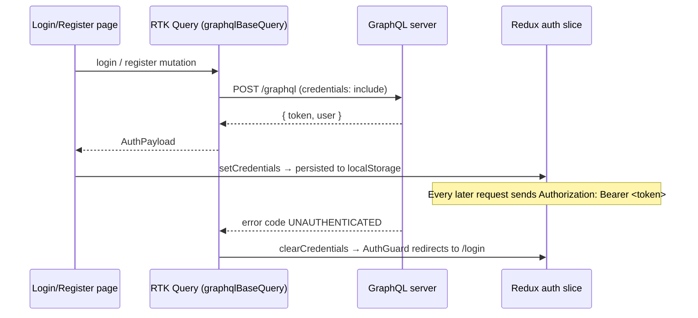

# nextjs-redux-graphql-boilerplate-client

Next.js (App Router) + React + Redux Toolkit boilerplate that pairs with
**express-typescript-graphql-boilerplate-server**. Includes auth pages, a users list,
and a per-hour **FullCalendar** schedule.

| Route         | Page                   | Access    |
| ------------- | ---------------------- | --------- |
| `/login`      | Login                  | Guests    |
| `/register`   | Register               | Guests    |
| `/`           | Home                   | Signed in |
| `/users`      | Users (`users` query)  | Signed in |
| `/schedule`   | FullCalendar, 1h slots | Signed in |
| `/logout`     | Signs out → `/login`   | Anyone    |
| anything else | 404 Page Not Found     | Anyone    |

## Stack

- Next.js 16 (App Router, TypeScript)
- Redux Toolkit 2 + RTK Query (GraphQL over `fetch`, no Apollo needed)
- FullCalendar 7 (`@fullcalendar/react` + `@fullcalendar/react-scheduler` for resource views)

## Getting started

```bash
cp .env.example .env.local
npm install
npm run dev          # http://localhost:2400
```

No backend yet? Set `NEXT_PUBLIC_MOCK_API=true` in `.env.local` — an in-browser mock
answers the auth/users operations so you can click through every page.

## Linting and formatting

ESLint 9 (flat config in `eslint.config.mjs`: Next.js core-web-vitals + TypeScript rules,
including the React Compiler checks from React Hooks v7) and Prettier (`.prettierrc.json`).
`eslint-config-prettier` switches off ESLint rules that would clash with Prettier.

```bash
npm run lint          # report problems
npm run lint:fix      # auto-fix what ESLint can
npm run format        # rewrite files with Prettier
npm run format:check  # fail if anything isn't formatted (for CI)
```

Editor: install the ESLint and Prettier extensions and turn on "format on save" with
Prettier as the default formatter. Next.js 16 no longer runs ESLint during `next build`,
so run `npm run lint` yourself or in CI.

## Deploying with Docker (Droplet + shared Nginx proxy)

Files: `Dockerfile` (multi-stage, Next.js standalone output, non-root), `docker-compose.yaml`,
`nginx.conf` (server block for the shared proxy) and `.dockerignore`.

1. **Once per Droplet**, the shared network the proxy and apps join:
   `docker network create web` (skip if it exists).
2. **Set the build-time values** in a `.env` next to `docker-compose.yaml`:
    ```env
    NEXT_PUBLIC_GRAPHQL_URL=https://scheduling-api.masings.com/graphql
    NEXT_PUBLIC_MOCK_API=false
    NEXT_PUBLIC_FULLCALENDAR_LICENSE_KEY=your-key
    ```
    `NEXT_PUBLIC_*` values are baked into the browser bundle during the build, so after
    changing them run `docker compose up -d --build`, not just a restart.
3. **Build and start:** `docker compose up -d --build`
4. **Proxy:** copy `nginx.conf` into the proxy's `conf.d/` as `scheduling.conf`
   (it serves `scheduling.masings.com` over HTTPS with the shared `masings-apps`
   certificate), then `docker exec <nginx-proxy> nginx -t && docker exec <nginx-proxy> nginx -s reload`.
   The domain needs a DNS A record pointing at the Droplet, and the certificate must
   include `scheduling.masings.com`.

The proxy reaches the app by its network alias `nextjs-redux-boilerplate-client:3000`
(every project's service is named `app`, so the alias keeps them apart). With
`output: "standalone"`, use `npm run dev` locally; `next start` prints a warning.

## How auth works



- `StoreProvider` restores the session from `localStorage` on load and keeps it in sync.
- `(protected)/layout.tsx` wraps pages in `AuthGuard` (redirects guests to `/login?next=…`
  and refreshes the user with the `me` query).
- `(auth)/layout.tsx` wraps login/register in `GuestGuard` (signed-in users go home).
- `/logout` calls the `logout` mutation (so the server can revoke a refresh token/cookie),
  then clears Redux state and the RTK Query cache.

## Matching your server schema

The GraphQL documents are **anticipated** from a typical type-graphql auth + RBAC setup:

<!-- prettier-ignore -->
```graphql
mutation Register($input: RegisterInput!) { register(input: $input) { token user { ...UserFields } } }
mutation Login($input: LoginInput!)       { login(input: $input)    { token user { ...UserFields } } }
mutation Logout                           { logout }
query Me                                  { me    { ...UserFields } }
query Users                               { users { data { ...UserFields } page limit total totalPages } }

fragment UserFields on User { id name email role { id name } extraPerms createdAt }
```

If your resolvers differ, edit only:

1. `src/mods/*/graphql/*.graphql` — operation names, inputs, selected fields
2. Run `npm run codegen` — regenerates the typed documents and types in `src/gql/`
3. `transformResponse` in `src/mods/auth/authApi.ts` / `src/mods/users/usersApi.ts` — if a top-level field name changed

## Project structure

```
src/
├─ app/
│  ├─ layout.tsx               Root layout + Redux StoreProvider
│  ├─ not-found.tsx            404
│  ├─ logout/page.tsx
│  ├─ (auth)/                  Guest-only route group
│  │  ├─ layout.tsx            GuestGuard
│  │  ├─ login/page.tsx
│  │  └─ register/page.tsx
│  └─ (protected)/             Signed-in route group
│     ├─ layout.tsx            AuthGuard + Navbar + collapsible Sidebar
│     ├─ page.tsx              Home
│     ├─ users/page.tsx
│     ├─ schedule/page.tsx     Loads ScheduleCalendar client-side only
│     ├─ manage/page.tsx       Therapists, rooms & services (with price history)
│     └─ reports/page.tsx      Weekly / monthly / annual sales reports
├─ mods/                       One folder per module (feature): its components, GraphQL, API, state, types
│  ├─ auth/
│  │  ├─ components/           AuthForm, AuthGuard, GuestGuard
│  │  ├─ graphql/auth.graphql  Register, Login, Logout, Me
│  │  ├─ authApi.ts            RTK Query endpoints (injected into baseApi)
│  │  ├─ authSlice.ts          Token + current user
│  │  ├─ usePermissions.ts     can("createRoom") from the `session` query (UI only)
│  │  └─ types.ts              App-facing auth types (derived from codegen)
│  ├─ users/
│  │  ├─ graphql/              user.fragment.graphql (UserFields), users.graphql
│  │  └─ usersApi.ts
│  └─ schedule/
│     ├─ components/           ScheduleCalendar, TherapistPanel, BookingDialog,
│     │                        ManageTherapists/Rooms/Services + their dialogs
│     ├─ graphql/              schedule.fragment.graphql, therapists/rooms/services/bookings.graphql
│     ├─ lib/availability.ts   Scheduling rules (instant feedback; the server enforces them too)
│     ├─ lib/useScheduleData.ts  Therapists + rooms + services + bookings for a range
│     ├─ lib/pricing.ts        Price lookup (same rules as the server), ₱ formatting
│     ├─ scheduleApi.ts        RTK Query endpoints (injected into baseApi)
│     ├─ scheduleSlice.ts      Visible calendar range
│     └─ types.ts              App-facing schedule types (derived from codegen)
│  └─ reports/
│     ├─ components/           SalesReportView, SalesChart, TherapistServiceTable, …
│     ├─ graphql/reports.graphql  SalesReport
│     ├─ lib/                  period.ts (ranges, labels), excel.ts (Download Excel, ExcelJS)
│     ├─ reportsApi.ts         RTK Query endpoint (injected into baseApi)
│     └─ types.ts
├─ components/                 Shared UI: layout/ (Navbar, Sidebar), ui/ (Loader, Dialog)
├─ lib/
│  ├─ graphqlBaseQuery.ts      RTK Query base query (Bearer token, errors, auto sign-out)
│  ├─ useMediaQuery.ts
│  └─ mocks/mockGraphql.ts     Offline mock (NEXT_PUBLIC_MOCK_API=true)
├─ store/                      makeStore, baseApi (no endpoints), typed hooks, ui slice, StoreProvider
└─ gql/                        GENERATED by `npm run codegen` — don't edit
```

## Layout

The navbar holds the menu toggle, profile and Log out; page links live in a collapsible
sidebar. The open/closed state is in `store/uiSlice.ts` and remembered in localStorage.
On desktop the sidebar pushes the page; under 768px it slides over it with a backdrop and
closes after you pick a page.

## Mobile

Under 768px (`MOBILE_QUERY` in `src/lib/useMediaQuery.ts`): the sidebar overlays the page,
the Schedule page shows Day view only with a compact toolbar, therapist columns keep a
minimum width (`dayMinWidth`) and the grid scrolls sideways, touch drags start after a
300ms hold, and the therapist roster starts collapsed. Check layouts in your browser's
device toolbar or on a phone.

## The schedule

The Schedule page is a FullCalendar **resource time grid**: one column per massage
therapist, 1-hour rows (Day / Week switcher).

- **Day view:** `resources` is a function FullCalendar calls on every navigation
  (`refetchResourcesOnNavigate`). It returns only therapists working that day, so a weekly
  day off or one-off leave removes their column.
- **Week view:** one set of columns spans the week, so off-days are greyed out with
  per-therapist `businessHours`, and leave days with grey background events.
- **Booking dialog:** drag down a therapist's column (10-minute steps) or press
  **+ New booking** to open it; click a booking to edit or cancel it. Fields: client,
  therapist, date, start, duration (presets like 1h 20m, or custom minutes) and room —
  rooms already taken at that time are disabled. It won't save if the therapist is off or
  double-booked, the room is taken, or the time is outside opening hours.
- **Quick edits:** drag a booking to move it, drag its edge to resize, or drag it into another
  therapist's column to reassign (the room is kept if still free, otherwise another is picked).
- **Roster panel:** toggle weekly days off and leave for the visible day; the columns update
  straight away. A banner flags any booking assigned to a therapist who is off.

Data comes from the server's schedule module through `mods/schedule/scheduleApi.ts`:
`therapists`, `rooms` and `bookings(from, to)` for the visible dates (kept in
`scheduleSlice.ts`), plus `createBooking` / `updateBooking` / `deleteBooking` and
`updateTherapist` for the roster toggles. Roster toggles and drag-to-move update the cache
optimistically and roll back if the server refuses; the booking dialog shows the server's error
(e.g. `ROOM_TAKEN` when someone else took the slot). The same rules live in
`mods/schedule/lib/availability.ts` for instant feedback. Run `npm run seed` on the server for
sample therapists and rooms, or add them on the **Therapists & rooms** page (`/manage`). Its
buttons follow the signed-in user's permissions (`createTherapist`, `updateRoom`, …; a super
admin has all of them), and deleting is refused while a therapist or room has upcoming
bookings.

### Services and prices

Every booking has a **service** (Fuyu, Natsu, Haru, Shiki, Aki). The booking dialog only offers
the lengths a service is sold in (Fuyu: 60 or 80 minutes; Aki: any length) and shows the price
for that date. Services and their prices are managed on **Manage** (`/manage`). A price applies
to a length (or any length), to some weekdays (Aki: Mon–Thu ₱699, Fri–Sun ₱799) and to a period.
**Change price** ends the current price the day before the new one starts, so past bookings
keep the price they had. Nothing is copied onto bookings: the server looks the price up by date
whenever a report runs.

### Reports

**Reports** (`/reports`, needs `readReports`) shows a daily, weekly (Mon–Sun), monthly or annual
sales report: revenue, services rendered per therapist and per service, the prices that applied, a
revenue chart, and any bookings that couldn't be priced. Only bookings that have ended count,
unless **Include upcoming bookings** is ticked. **Download Excel** saves an `.xlsx` workbook built
in the browser with [ExcelJS](https://github.com/exceljs/exceljs) (loaded only when you export):
Summary, By therapist, By service & price, By hour / By day / By month and Unpriced sheets, with styled
headers, frozen panes, filters, ₱ formats and live `SUM` formulas for the totals. **Print**
prints the page without the app chrome.

**License:** resource views are FullCalendar Premium (`@fullcalendar/react-scheduler`). The
default `CC-Attribution-NonCommercial-NoDerivatives` key is for trials and non-commercial use;
set `NEXT_PUBLIC_FULLCALENDAR_LICENSE_KEY` to a commercial key before using it in a business.

## Adding a page

1. Create `src/app/(protected)/<name>/page.tsx` — it's automatically behind `AuthGuard`.
2. Add it to `navItems` in `src/components/layout/Sidebar.tsx`.
3. Put its UI, state and types in `src/mods/<name>/`. For data, write the operation in
   `src/mods/<name>/graphql/<name>.graphql`, run `npm run codegen`, then add an endpoint in
   `src/mods/<name>/<name>Api.ts` with `baseApi.injectEndpoints` using the generated `<Name>Document`.
