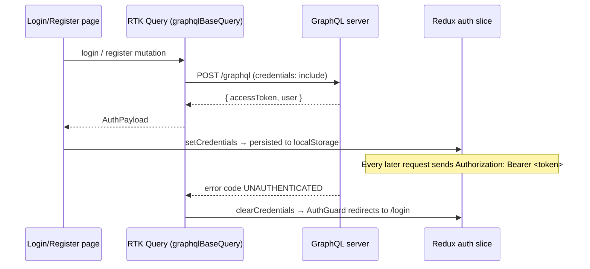

# nextjs-redux-graphql-boilerplate-client

Next.js (App Router) + React + Redux Toolkit boilerplate that pairs with
**express-typescript-graphql-boilerplate-server**. Includes auth pages, a users list,
and a per-hour **FullCalendar** schedule.

| Route       | Page                    | Access    |
| ----------- | ----------------------- | --------- |
| `/login`    | Login                   | Guests    |
| `/register` | Register                | Guests    |
| `/`         | Home                    | Signed in |
| `/users`    | Users (`users` query)   | Signed in |
| `/schedule` | FullCalendar, 1h slots  | Signed in |
| `/logout`   | Signs out → `/login`    | Anyone    |
| anything else | 404 Page Not Found    | Anyone    |

## Stack

- Next.js 16 (App Router, TypeScript)
- Redux Toolkit 2 + RTK Query (GraphQL over `fetch`, no Apollo needed)
- FullCalendar 7 (`@fullcalendar/react` — plugins are subpath imports in v7)

## Getting started

```bash
cp .env.example .env.local
npm install
npm run dev          # http://localhost:3000
```

No backend yet? Set `NEXT_PUBLIC_MOCK_API=true` in `.env.local` — an in-browser mock
answers the auth/users operations so you can click through every page.

## How auth works



- `StoreProvider` restores the session from `localStorage` on load and keeps it in sync.
- `(protected)/layout.tsx` wraps pages in `AuthGuard` (redirects guests to `/login?next=…`
  and refreshes the user with the `me` query).
- `(auth)/layout.tsx` wraps login/register in `GuestGuard` (signed-in users go home).
- `/logout` calls the `logout` mutation (so the server can revoke a refresh token/cookie),
  then clears Redux state and the RTK Query cache.

## Matching your server schema

The GraphQL documents are **anticipated** from a typical type-graphql auth + RBAC setup:

```graphql
mutation Register($input: RegisterInput!) { register(input: $input) { accessToken user { ...UserFields } } }
mutation Login($input: LoginInput!)       { login(input: $input)    { accessToken user { ...UserFields } } }
mutation Logout                           { logout }
query Me                                  { me    { ...UserFields } }
query Users                               { users { ...UserFields } }

fragment UserFields on User { id name email role { id name } permissions createdAt }
```

If your resolvers differ, edit only:

1. `src/graphql/operations.ts` — operation names, inputs, selected fields
2. `src/types/auth.ts` — the matching TypeScript types
3. `transformResponse` in `src/store/api.ts` — if a top-level field name changed

## Project structure

```
src/
├─ app/
│  ├─ layout.tsx               Root layout + Redux StoreProvider
│  ├─ not-found.tsx            404
│  ├─ logout/page.tsx
│  ├─ (auth)/                  Guest-only route group
│  │  ├─ layout.tsx            GuestGuard
│  │  ├─ login/page.tsx
│  │  └─ register/page.tsx
│  └─ (protected)/             Signed-in route group
│     ├─ layout.tsx            AuthGuard + Navbar
│     ├─ page.tsx              Home
│     ├─ users/page.tsx
│     └─ schedule/page.tsx     Loads ScheduleCalendar client-side only
├─ components/                 AuthForm, AuthGuard, GuestGuard, Navbar, Loader, ScheduleCalendar
├─ graphql/operations.ts       All GraphQL documents
├─ lib/graphqlBaseQuery.ts     RTK Query base query (Bearer token, errors, auto sign-out)
├─ lib/mockGraphql.ts          Offline mock (NEXT_PUBLIC_MOCK_API=true)
├─ store/                      makeStore, typed hooks, api slice, auth + schedule slices
└─ types/auth.ts
```

## The schedule

`ScheduleCalendar` renders a `timeGridDay` view with `slotDuration="01:00:00"`
(Day / Week / Month switcher in the toolbar):

- drag across hours → prompt for a title → event added
- drag or resize an event → updated
- click an event → delete

Events live in `store/scheduleSlice.ts` (local only, seeded with two events for today).
When the server gets a scheduler module, add `schedules` / `createSchedule` / … endpoints
to `store/api.ts` and swap the slice actions for those mutations.

## Adding a page

1. Create `src/app/(protected)/<name>/page.tsx` — it's automatically behind `AuthGuard`.
2. Add a link in `src/components/Navbar.tsx`.
3. Add any GraphQL operation to `operations.ts` and an endpoint in `store/api.ts`.
